# VeriGate

## AI-Powered Application Validation, Document Authentication and Regulatory Compliance Verification for AICTE Extension of Approval (EoA)

---

### 1. Title Page

| **Field** | **Details** |
|---|---|
| **Project name** | **VeriGate** — Evidence-Gated AI Decision Support for AICTE EoA Validation |
| **Tagline** | *AI advises. Evidence decides. Humans approve.* |
| **Team Members** | Atharva Sachin Bhangale<br>Naresh Balasaheb Kekan<br>Tejas Siddheshwar Bagade<br>Vaibhavi Dnyaneshwar Kothare<br>Soham Narayan Udhane<br>Nayan Aravind Khune |
| **College name** | All India Shri Shivaji Memorial Society's College of Engineering, Pune |
| **SIH edition** | Smart India Hackathon 2026 |
| **Problem Statement ID** | **SIH26261** |
| **Problem Statement Title** | AI-Powered Application Validation, Document Authentication and Regulatory Compliance Verification |
| **Organisation** | All India Council for Technical Education (AICTE), Ministry of Education, Government of India |
| **Theme / Category** | Smart Automation / Software |
| **Prototype** | Functional web prototype (React + FastAPI), CPU-only, synthetic data |
| **Live prototype** | **https://verigate-app.vercel.app** |
| **Demo video** | **https://drive.google.com/file/d/1ok8D4ddMCRJCyEIHwnPq0eNAzhgTWuIm/view?usp=sharing** · QR: `docs/demo-video-qr.png` |
| **Source code** | https://github.com/atharva23x/verigate |


---

### 2. Abstract

Every academic year, AICTE processes Extension of Approval (EoA) and related applications from technical institutions across India. Each application carries a large, heterogeneous set of supporting documents — the EoA form, previous approval letters, Fire and Emergency Safety NOCs, building stability certificates, land or lease deeds, affidavits, pharmacy council registrations and more. Officials must check that every document is present, current, internally consistent and genuine, and that the institution's declared intake, category and infrastructure match AICTE's own records. Much of this is repetitive manual scrutiny. Missing or expired certificates, edited dates, re-used documents and mismatched institutional data are often discovered late, delaying approvals and increasing administrative load.

**VeriGate** is an AI-enabled decision-support platform that performs this preliminary validation at the point of submission. It reads uploaded PDFs, extracts structured fields with page-level bounding boxes and confidence scores, applies a category-aware checklist derived from the Approval Process Handbook, cross-checks declared values against AICTE master records, detects image-level tampering and duplicated documents, and verifies documents against issuing-authority sources wherever an authorised API or portal exists. Its central safety property is the **Evidence Gate**: the system marks an application **VERIFIED** only when *all* evidence conditions hold — OCR confidence above threshold, every issuer-backed document confirmed, no critical rule violation, no tampering or duplication, and sufficient cross-record consistency. Otherwise it **abstains** and routes the case to a human review queue with evidence-linked reasons.

The result is faster screening, consistent application of configurable rules, traceable verification and a complete audit trail — while statutory scrutiny, inspection and final approval remain entirely with competent AICTE authorities.

---

### 3. Problem Statement

#### 3.1 Real-world context

AICTE is the statutory authority for technical education in India under the **AICTE Act, 1987**. Institutions offering technical programmes must obtain approval, and existing institutions must renew it annually through **Extension of Approval (EoA)** under the applicable **Approval Process Handbook (APH)**. The APH for 2024-25 to 2026-27 runs to more than 200 pages and defines category-wise requirements covering land, built-up area, classrooms, laboratories, faculty, library, safety and finance, along with the documents that must be uploaded as evidence.

The application volume is national in scale, the document mix differs by category (Engineering, Management, Pharmacy and others), and rules change between academic cycles.

#### 3.2 What actually goes wrong today

| Failure mode | Real-world consequence |
|---|---|
| **Missing mandatory document** (e.g., Fire Safety NOC) | Application is incomplete; scrutiny stops and the institution is asked to resubmit |
| **Expired certificate** (Fire NOC, building stability, council registration) | Compliance cannot be established for the academic year |
| **Inconsistent data** (declared intake, institution name, address, AICTE ID) | Application contradicts AICTE master records or its own documents |
| **Altered document** (edited date, replaced page, pasted seal) | A false claim may pass preliminary scrutiny; detection requires manual suspicion |
| **Re-used document** (same certificate filed by another institution or application) | Duplicate or borrowed evidence weakens the approval process |
| **Issuer confirmation delay** | Officials wait on overburdened issuing authorities; files age in the queue |
| **Repetitive manual checking** | Scarce expert time is spent on mechanical verification instead of judgement |

#### 3.3 Why current practice struggles

1. **Manual, document-by-document scrutiny** does not scale with application volume and document variety.
2. **Portal validation is largely form-level.** It can enforce mandatory fields, but it does not read the contents of a scanned certificate or compare them with another document.
3. **Verification is fragmented.** Fire NOCs, building certificates, pharmacy council registrations and university NOCs sit with different authorities, each with its own process and no common machine interface.
4. **Generic AI tools are unsafe here.** A general-purpose chatbot or OCR tool produces fluent output without provenance, cannot show *where* on the page a value came from, cannot prove which rule was applied, and offers no audit trail — all unacceptable for a regulatory decision.
5. **Adverse action must never be automated.** Any suspicion of forgery is a *preliminary indicator*, not a finding of misconduct. The system must not reject an institution on its own.

#### 3.4 Problem definition

> Build a secure, integrated, AI-enabled decision-support platform that validates EoA application information and supporting documents against authorised institutional records and configurable regulatory requirements; identifies missing, expired, inconsistent or potentially manipulated evidence; facilitates verification through original issuing authorities; flags infrastructure and compliance gaps for official review; and presents every finding with linked evidence and a clear verification status — while retaining all statutory scrutiny, inspection and final decision-making with competent AICTE authorities.

---

### 4. Proposed Solution

**VeriGate** is a verification workspace that sits in front of — or integrates with — the AICTE application portal. It converts an uploaded application into a structured, evidence-linked verification record.

#### 4.1 The six functional pillars

| # | Pillar | What VeriGate does |
|---|---|---|
| **1** | **Category-aware intake** | Identifies the application category and loads the applicable APH-derived checklist and validation rules. Rules are configuration, not hard-coded logic. |
| **2** | **Document intelligence** | Renders every PDF page, runs OCR, classifies documents and extracts fields (document number, issue/expiry date, authority, AICTE ID, intake) with a page number, bounding box and confidence for each field. |
| **3** | **Authenticity and anomaly analysis** | Error Level Analysis (ELA) for localised recompression anomalies, perceptual hashing (pHash) for duplicated documents, plus date, identifier and metadata consistency checks. Every flag carries the page and coordinates of the evidence. |
| **4** | **Issuer verification** | Queries authorised issuing-authority sources through an adapter layer and records source, timestamp and outcome. Statuses distinguish verified, mismatch, expired, pending, source unavailable and manual review. |
| **5** | **Compliance assistance** | Compares submitted evidence against configurable documentary and infrastructure requirements and flags gaps that need more evidence or physical inspection. |
| **6** | **Evidence Gate, dashboard and audit** | Applies the gate, produces a risk-ranked dashboard and manual review queue, generates an A4 verification report with a human sign-off block, and writes every action to an append-only audit log. |

#### 4.2 The core design principle: abstain instead of guessing

Conventional automation tries to answer *"Is this application valid?"*. VeriGate answers a narrower and safer question:

> **"Is the evidence strong enough for a machine to mark this application VERIFIED?"**

If the answer is yes, the application is marked **VERIFIED**. If any link in the evidence chain is weak, the system returns **INSUFFICIENT_EVIDENCE** and sends the case to a human. It never auto-rejects and never certifies on partial evidence. This is a deliberate **selective prediction** design: high precision on the cases it accepts, explicit abstention everywhere else.

**Issue date in the future → flagged by rule, bounding box drawn on the page, officer decides.**

---

### 5. Objectives

#### 5.1 Primary objectives (aligned to the problem statement)

1. **Detect incomplete submissions early** — identify missing, expired, unreadable or internally inconsistent information and documents at the application stage.
2. **Reduce repetitive manual checking** — reuse institutional records already available in authorised AICTE systems instead of asking officials to re-key and re-compare them.
3. **Surface potential manipulation** — detect alterations, duplicated documents, mismatched identifiers and irregular dates, and present them as preliminary indicators with evidence.
4. **Enable authorised source verification** — query issuing-authority APIs, portals, QR codes and digital signatures where legally and technically available, and record provenance.
5. **Assist compliance review** — check documentary and infrastructure evidence against configurable APH-derived requirements and flag cases needing additional evidence or inspection.
6. **Make every outcome explainable and auditable** — attach a rule ID, reason, document, page and bounding box to each finding, and keep an immutable trail of rules applied, sources queried and human decisions.

#### 5.2 Technical and evaluation objectives

| Objective | Target for prototype evaluation |
|---|---|
| Field extraction quality | Character/word accuracy measured on a labelled synthetic test set; target ≥ 95% on machine-generated PDFs |
| Rule evaluation correctness | 100% agreement with the expected checklist outcome on the curated scenario set |
| Tamper localisation | Correct page and overlapping bounding box on the seeded tampered scenario |
| Duplicate detection | Zero false positives on same-template/different-data documents; exact reuse detected |
| Evidence Gate safety | No application with a known critical defect is marked VERIFIED |
| Explainability | 100% of flags carry rule ID, reason and, where applicable, document/page/bbox |
| Audit completeness | 100% of validate, review, export and delete actions recorded |
| Processing time | End-to-end validation of a 5-document application in tens of seconds on CPU |

---

### 6. Existing System

#### 6.1 How approval processing works today

| Layer | Current mechanism | Limitation |
|---|---|---|
| Application submission | AICTE web portal / NSWS forms with document upload | Enforces presence of fields, not the truth or consistency of document contents |
| Document scrutiny | Manual opening of each PDF by officials | Slow, variable between officers, hard to audit at field level |
| Institutional records | Separate AICTE databases, previous approval letters, affidavits, compliance and payment records | Cross-checking is manual and depends on what the officer remembers to query |
| Issuer confirmation | Email, phone, physical correspondence or the issuer's own portal | No standard machine interface; long turnaround; no unified timestamped record |
| Forgery detection | Visual inspection; occasionally external forensic help | Expertise-intensive; subtle edits and re-used templates are easy to miss |
| Infrastructure verification | Photographs, videos, floor plans, site inspections | Inspection is expensive and usually happens after preliminary scrutiny |
| Record keeping | Files, notes and portal history | Difficult to reconstruct why a decision was taken |

#### 6.2 Why existing tools are not enough

- **Generic OCR / document AI** extracts text but does not apply APH rules, does not verify issuers, and does not preserve evidence coordinates for review.
- **Consumer forgery detectors** return a score without regulatory context, calibration or an audit trail, and are not designed for scanned government certificates.
- **Rule engines** can check structured form data but cannot read a scanned Fire NOC.
- **DigiLocker / API Setu** provide authentic digital documents for many categories, but coverage is uneven and integration is institution-specific; an EoA platform must handle both digital and scanned paper evidence.
- **LLM chatbots** may summarise documents but can hallucinate, cannot prove provenance and are unsuitable as the decision layer in a statutory process.

**Gap:** there is no single system that combines document understanding, anomaly detection, cross-record consistency, issuer verification and explainable human review under one configurable regulatory rule set.

---

### 7. Proposed System

#### 7.1 What is different

VeriGate is not a replacement for the AICTE portal or for the officer. It is a **pre-scrutiny and evidence layer** that produces a structured, risk-ranked case file.

```
Upload → Read → Extract → Check rules → Check issuers → Check authenticity
      → Compare with master records → EVIDENCE GATE → Human review → Audit
```

#### 7.2 Verification status model

| Status | Meaning | Who acts |
|---|---|---|
| `VERIFIED` | All gate conditions satisfied; evidence is machine-verifiable | Officer may proceed with normal scrutiny |
| `INSUFFICIENT_EVIDENCE` | One or more conditions failed or could not be established | Routed to Manual Review Queue |
| `IN_REVIEW` | A reviewer has opened the case | Reviewer |
| `APPROVED` / `REJECTED` | Human decision recorded with a mandatory comment | Authorised reviewer |
| `SOURCE_UNAVAILABLE` | Issuer source did not respond | Manual confirmation; never auto-rejected |
| `MANUAL_REVIEW` | Automated verification inconclusive or unsupported | Manual confirmation |

#### 7.3 Advantages over the existing system

| Dimension | Existing manual process | VeriGate |
|---|---|---|
| Completeness check | Officer-by-officer, memory-dependent | Deterministic, category-wise checklist with rule IDs |
| Document reading | Human reading of every page | OCR + structured extraction with confidence and coordinates |
| Cross-record consistency | Manual lookup | Feature-based model compared with AICTE master data |
| Forgery indicators | Visual suspicion | ELA heatmap, bounding box and duplicate hashes, flagged as advisory |
| Issuer verification | Email/phone, untracked | Adapter layer with status, source and timestamp recorded |
| Repeatability | Varies by officer and workload | Same rules produce the same result |
| Explainability | File notes | Rule ID + reason + document + page + bbox + confidence |
| Audit | Reconstructed after the fact | Append-only log written as work happens |
| Safety | Human judgement alone | Human judgement plus an explicit abstention boundary |

---

### 8. Methodology

#### 8.1 End-to-end workflow

| Stage | Name | Processing | Output |
|---|---|---|---|
| 1 | **Pre-process** | Render every uploaded PDF page to a normalised image; record page count | Page images ready for OCR and overlay |
| 2 | **OCR** | Engine chain: seeded ground truth (demo) → PaddleOCR → Tesseract → embedded PDF text layer → blank; each token gets a normalised box and confidence | Page text, tokens, mean OCR confidence |
| 3 | **Field extraction** | Rule/regex-based extraction of institution name, AICTE ID, document number, issue date, expiry date, issuing authority, intake, QR token and signature | Structured fields, each with page, bbox and confidence |
| 4 | **Rule check** | Load `rules.json` for the category; verify mandatory documents, required fields, validity, future dates and expiry | Checklist with `OK`, `MISSING`, `EXPIRED`, `INCOMPLETE` |
| 5 | **Issuer check** | For documents mapped to an issuer portal, call the authorised adapter with document number, QR token and signature | `VERIFIED`, `INVALID`, `EXPIRED`, `NOT_FOUND`, `SOURCE_UNAVAILABLE`, `MANUAL_REVIEW` + timestamp |
| 6 | **Tamper + duplicate check** | ELA on flat regions of each page; 64-bit pHash compared across the document corpus; text similarity confirms true reuse | Tamper score, hot-region bbox, duplicate pairs |
| 7 | **Consistency check** | Build an 11-feature vector (name similarity, AICTE ID match, category, address, intake, date plausibility, expiry alignment, issuer ratio, OCR confidence, tamper inverse, duplicate inverse) and score it with XGBoost | Consistency score 0–1 and weakest features |
| 8 | **Evidence Gate** | Apply all gate conditions; compute gate confidence; set risk score and status | `VERIFIED` or `INSUFFICIENT_EVIDENCE` + reasons |
| 9 | **Finalise** | Persist flags, write audit entries, publish validation report | Case file, dashboard entry, review queue item |

#### 8.2 Evidence Gate logic

An application is marked **VERIFIED** only if **all** of the following hold:

| # | Condition | Threshold |
|---|---|---|
| 1 | Mean OCR confidence | **> 0.90** |
| 2 | Every issuer-backed document confirmed | **all `VERIFIED`** |
| 3 | Critical rule violations | **0** |
| 4 | Tamper score | **< 0.30** |
| 5 | Duplicate documents | **0** |
| 6 | Cross-record consistency | **≥ 0.70** |

Otherwise the result is **`INSUFFICIENT_EVIDENCE`**, with one reason object per failed condition.

**Reported confidence is the weakest link**, not an average:

```
gate_confidence = min( OCR_confidence,
                       consistency_score,
                       1 − tamper_score,
                       issuer_score )
```

This is an explanation for the human reviewer, not the pass condition itself. A high average cannot hide a single unverified certificate.

#### 8.3 Risk ranking

```
risk_score = 1 − gate_confidence
if any CRITICAL flag: risk_score = min(1.0, risk_score + 0.15)
```

Applications are sorted by risk on the dashboard, so the cases most likely to need attention surface first.

#### 8.4 Rule configuration

Rules live in a versioned JSON file, not in code. Each rule declares:

- `rule_id` (e.g., `APH-MGT-003`, `APH-GEN-T01`)
- document type and human-readable name
- whether validity, signature or QR is required
- required fields
- issuer portal (or `null` if no automated source exists)
- severity (`CRITICAL`, `WARN`, `INFO`)
- the global check to run (future date, expired, missing fields, tamper, duplicate, issuer, consistency, OCR)

Changing an APH requirement means editing configuration and re-running validation — not redeploying the model.

#### 8.5 Human review and decision roll-up

1. An `INSUFFICIENT_EVIDENCE` case appears in the **Manual Review Queue**, ranked by risk.
2. The reviewer sees each flag with its rule ID, reason, document, page, bounding box and confidence.
3. The reviewer records **Approve**, **Reject** or **Request Information**, with a mandatory comment for the trail.
4. Decision status rolls up to the application (`IN_REVIEW`, `APPROVED`, `REJECTED`).
5. Every decision is written to the audit log and appears in the downloadable verification report.

#### 8.6 Built-in demonstration scenarios

| Scenario | Application | What it proves |
|---|---|---|
| **A** | Clean application | Gate returns `VERIFIED` with zero flags |
| **B** | Missing mandatory Fire NOC | Checklist marks the document `not uploaded`; flag cites `APH-MGT-003`; gate abstains |
| **C** | Tampered date on previous EoA letter | ELA produces a red bounding box over the edited region; issuer reports signature invalid |
| **D** | Issuer portal unavailable | `SOURCE_UNAVAILABLE`, routed to review, **never auto-rejected** |
| **E** | Low OCR confidence | `INSUFFICIENT_EVIDENCE`; reviewer must read the document manually |

These scenarios are seeded with synthetic PDFs and mock issuer records. No real institutional data is used.

---

### 9. Technology Stack

#### 9.1 Application stack

| Layer | Technology | Purpose |
|---|---|---|
| **Frontend** | React 18, TypeScript 5, Vite 5 | Single-page verification workspace |
| **Styling / UI** | Tailwind CSS 3, Lucide React | Responsive, accessible dashboard and overlays |
| **HTTP client** | Axios | Authenticated API calls |
| **Backend** | Python 3.12, FastAPI, Uvicorn | REST API, background pipeline, OpenAPI docs |
| **Validation / schemas** | Pydantic v2 | Typed request/response contracts |
| **Database** | SQLAlchemy 2 + SQLite | Applications, documents, flags, reviews, audit, mock registries; PostgreSQL-ready |
| **Auth** | PBKDF2-SHA256 passwords, JWT (HS256), role guards | Officer / reviewer / auditor separation |
| **Reporting** | ReportLab | Downloadable A4 verification report with sign-off block |
| **PDF / image processing** | PyMuPDF, Pillow | Page rendering, PDF text layer, image handling |
| **Numerics** | NumPy, SciPy | ELA statistics, DCT hash, connected components |
| **Deployment** | Docker, Docker Compose | One-command local/on-prem deployment |

#### 9.2 AI, ML and analytical components

| Component | Technique / model | Role in the prototype |
|---|---|---|
| **OCR** | PaddleOCR (en+hi) → Tesseract → embedded PDF text layer | Text + token boxes + confidence; seeded ground truth in demo mode |
| **Document understanding** | Rule/regex field extraction over OCR tokens | Structured fields with page and bbox |
| **Cross-record consistency** | XGBoost binary classifier on 11 engineered features | Probability that the application matches the AICTE master record; deterministic weighted fallback if the model cannot train |
| **Tamper detection** | Error Level Analysis restricted to flat regions, block clustering, connected components | Localised anomaly score + normalised bounding box |
| **Duplicate detection** | 64-bit DCT perceptual hash + OCR text similarity | Detects the same file reused across applications without false-positiving on shared templates |
| **Rule engine** | Declarative JSON rules with severity and issuer mapping | Category-wise APH checklist and explainable flags |
| **Issuer verification** | Adapter layer with HMAC-signed mock portals and an HTTP mode | Demonstrates the integration contract for real APIs |

#### 9.3 Designed extension (not claimed as implemented)

| Future component | Candidate technology | Purpose |
|---|---|---|
| Layout-aware extraction | LayoutLMv3, Donut, TrOCR | Better accuracy on scans, tables and Hindi/regional text |
| Learned tamper detection | DocTamper-style model | Complements ELA on photographed and re-scanned documents |
| Infrastructure vision | Detection/segmentation model + floor-plan parsing | Compare photographs, videos and plans with declared labs, classrooms and built-up area |
| Digital signature validation | CCA-issued PKI, eSign verification | Validate PDF signatures and certificate chains |
| Authentic document pull | DigiLocker / API Setu requester APIs | Consent-based retrieval of issued certificates |
| Async scale-out | Redis + Celery workers, PostgreSQL, object storage | Parallel processing at national volume |

---

### 10. System Architecture

#### 10.1 Logical architecture

```
┌──────────────────────────────────────────────────────────────────────────────┐
│                              USER LAYER                                      │
│   Institution / Officer / Reviewer / Auditor  (role-based access)            │
│   React + TypeScript SPA  ·  Dashboard · Application Detail · Upload ·       │
│   Review Queue · Audit Log · Analytics · Issuer Status                       │
└───────────────────────────────┬──────────────────────────────────────────────┘
                                │ HTTPS · JWT bearer token
┌───────────────────────────────▼──────────────────────────────────────────────┐
│                           API LAYER  (FastAPI)                                │
│  /auth   /applications   /reviews   /audit-log   /dashboard   /issuer        │
│  Role guards · request validation · background validation tasks              │
└───────────────┬──────────────────────────────────────────────┬───────────────┘
                │                                              │
┌───────────────▼───────────────────────────┐   ┌──────────────▼───────────────┐
│        VALIDATION SERVICES                │   │      EVIDENCE & RECORDS      │
│                                           │   │                              │
│  1 Render (PyMuPDF)                       │   │  SQLite / PostgreSQL         │
│  2 OCR engine chain                       │   │   applications, documents,   │
│  3 Field extraction                       │   │   flags, reviews, audit,     │
│  4 Rule engine  ← rules.json              │   │   mock AICTE + issuer data   │
│  5 Issuer client ─────────────────────────┼──▶│                              │
│  6 ELA + pHash duplicate                  │   │  Object storage              │
│  7 XGBoost consistency                    │   │   uploads / page images /    │
│  8 EVIDENCE GATE                          │   │   ELA heatmaps / OCR ground  │
│  9 Report + audit                         │   │   truth                      │
└───────────────┬───────────────────────────┘   └──────────────────────────────┘
                │
┌───────────────▼──────────────────────────────────────────────────────────────┐
│                    EXTERNAL VERIFICATION SOURCES (authorised)                 │
│  AICTE master records · AICTE approval portal · DigiLocker / API Setu ·       │
│  State Fire & Emergency Services · State Technical Board / University ·      │
│  Pharmacy Council of India · UGC                                             │
└──────────────────────────────────────────────────────────────────────────────┘
```

#### 10.2 Physical / deployment view

```
Browser ──► React SPA (Vite dev server :5173, or static build behind Nginx)
                │  REST/JSON + JWT
                ▼
         FastAPI + Uvicorn (:8000)
                ├── SQLAlchemy ──► SQLite (demo)  or  PostgreSQL (pilot)
                ├── Local storage ──► uploads/, pages/, ela/, mock_ocr/
                └── Outbound HTTPS ──► issuer adapters / DigiLocker / API Setu
```

#### 10.3 Component responsibilities

| Component | Responsibility | Trust boundary |
|---|---|---|
| React SPA | Presentation, role-aware navigation, evidence overlay | Holds JWT; never sees another role's write rights |
| API layer | Authentication, authorisation, orchestration, audit writes | Validates every request and role |
| Pipeline | Nine-step validation with failure isolation | A failing step records an error and the gate abstains |
| Rule engine | Declarative checklist evaluation | Configuration controlled by authorised administrators |
| Issuer client | Adapter for authorised sources | Records source, result and timestamp; never bypasses access control |
| Evidence Gate | Final machine verdict | Cannot approve; can only certify evidence strength |
| Review module | Human decisions with comments | Reviewer role only; every decision audited |
| Audit log | Append-only history | No update or delete API |

#### 10.4 Data model (core entities)

```
User (id, username, password_hash, role, full_name)
   │
Application (id, ref_no, institution, category, aicte_id, intake, status,
   │          gate_status, gate_confidence, risk_score, checklist_json,
   │          ocr_confidence, consistency_score, tamper_score, issuer_status)
   ├── Document (id, doc_type, filename, page_count, ocr_text, ocr_confidence,
   │             extracted_json, phash, tamper_score, ela_bbox, duplicate_of)
   ├── Flag (id, rule_id, kind, severity, reason, page_no, bbox, status)
   │      └── ReviewDecision (decision, reviewer, comment, created_at)
   └── (audit entries reference application/entity IDs)

AuditLog (ts, actor, role, action, entity_type, entity_id, detail)
MockRecord (AICTE master record)      IssuerRecord (issuer portal registry)
```

---

### 11. Implementation

#### 11.1 Prototype status

The prototype runs entirely on localhost, on CPU, with synthetic data. Backend on `http://localhost:8000` (FastAPI + SQLite), frontend on `http://localhost:5173` (React + Vite). On first boot the backend seeds 30 synthetic applications, generated PDFs, mock AICTE master records and mock issuer records, then runs the full pipeline so the dashboard is immediately populated.

| Capability | Implemented | Notes |
|---|---|---|
| Category-wise checklist | ✅ | Engineering, Management, Pharmacy |
| PDF rendering + OCR | ✅ | Real engine chain available; seeded ground truth by default for deterministic demos |
| Field extraction with bbox | ✅ | Page, normalised coordinates, confidence |
| Cross-record consistency | ✅ | XGBoost trained at startup; heuristic fallback |
| Tamper detection + overlay | ✅ | ELA heatmap and red bounding box |
| Duplicate detection | ✅ | pHash + OCR text similarity |
| Issuer verification workflow | ✅ | Mock portals, six statuses, outage simulation, HMAC signatures |
| Evidence Gate | ✅ | Five AND-conditions + confidence |
| Manual review queue | ✅ | Approve / Reject / Request Information with comment |
| Audit log + CSV export | ✅ | Append-only, role-filtered |
| PDF verification report | ✅ | A4 report with verdict, signals, flags, checklist, sign-off |
| Analytics dashboard | ✅ | Gate outcomes, rule frequency, document gaps, risk buckets, queue aging |
| Issuer health page | ✅ | Portal status, verification rate, failure examples |
| Role-based access | ✅ | Auditor is read-only; write attempts return 403 |
| Infrastructure computer vision | ⚙️ | Designed extension; documentary compliance is implemented |
| Real DigiLocker / issuer APIs | ⚙️ | Adapter contract and HTTP mode implemented; live integration requires authorisation |

#### 11.2 Screens implemented

| Screen | Purpose |
|---|---|
| **Login** | Demo accounts for officer, reviewer and auditor |
| **Dashboard** | Stat cards, Evidence Gate outcomes, risk-ranked application table, scenario badges |
| **Upload** | Create an application, attach documents, watch live step-by-step pipeline progress |
| **Application Detail** | Verdict banner, evidence gate reasons, document viewer with field/tamper overlays, checklist, flags, consistency view, duplicate pairs, issuer outcomes, review actions, PDF report |
| **Review Queue** | Risk-ranked cases awaiting a human decision |
| **Analytics** | Portfolio trends: gate pass rate, category performance, most-frequent rules, document gaps, risk distribution, queue aging |
| **Issuer Status** | Up/down state of each issuer portal, checks performed, verification rate |
| **Audit Log** | Filterable append-only history with CSV export |

#### 11.3 Screenshots (captured from the running prototype)

| | |
|---|---|
| **Login — role-based demo accounts**<br>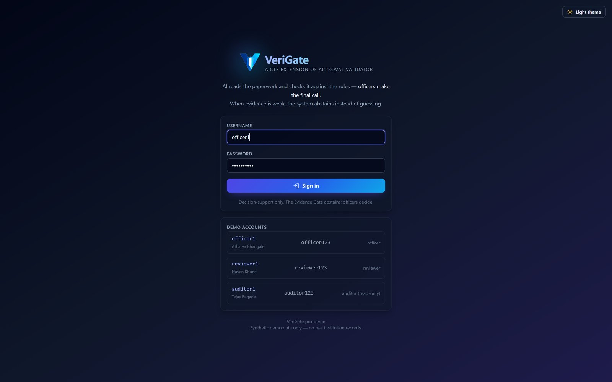 | **Dashboard — gate outcomes and risk-ranked applications**<br>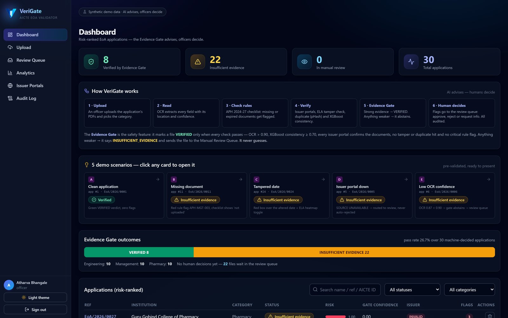 |
| **Upload — live nine-step pipeline progress**<br>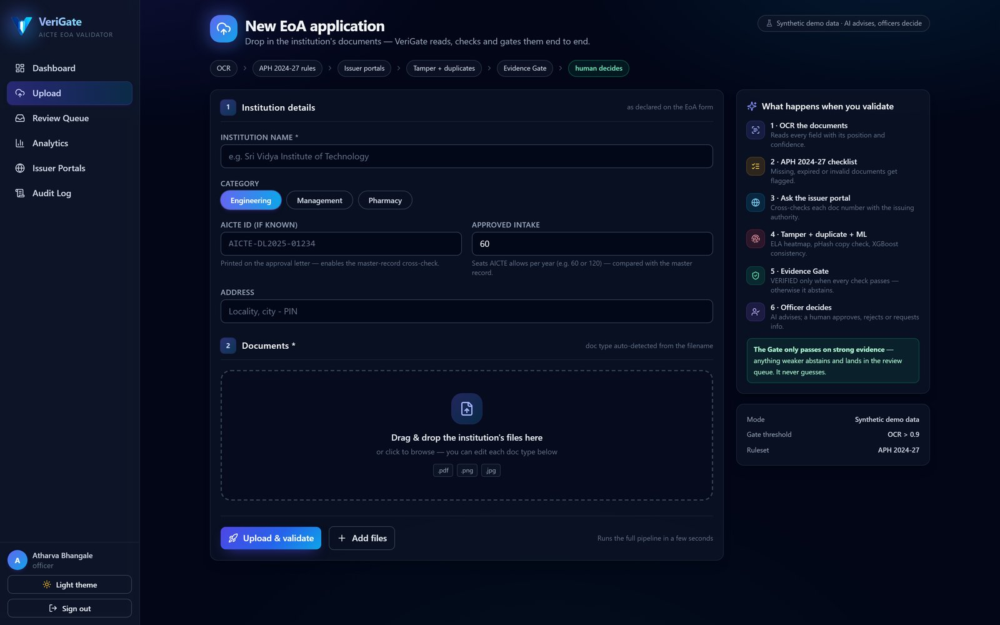 | **Scenario C — ELA bounding box over the altered date**<br>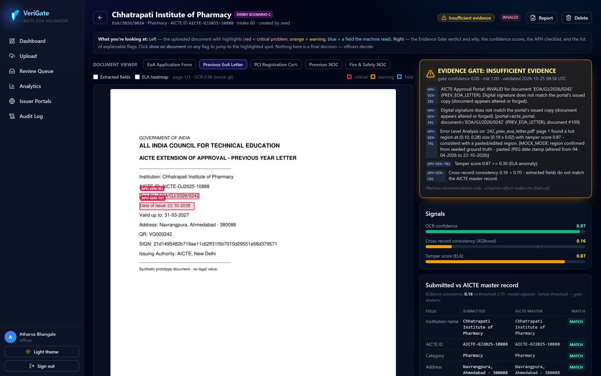 |
| **Extracted field boxes across the document**<br>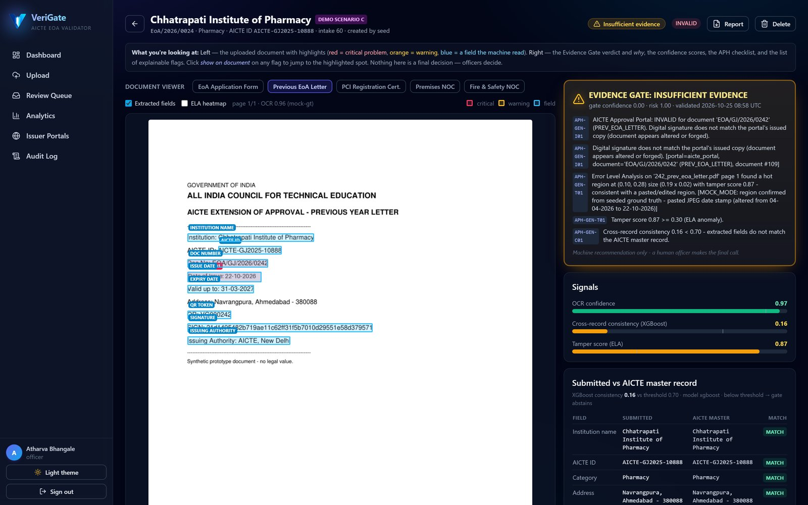 | **Scenario A — clean application marked VERIFIED**<br>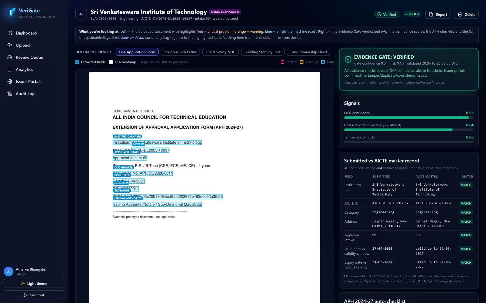 |
| **Manual review queue**<br>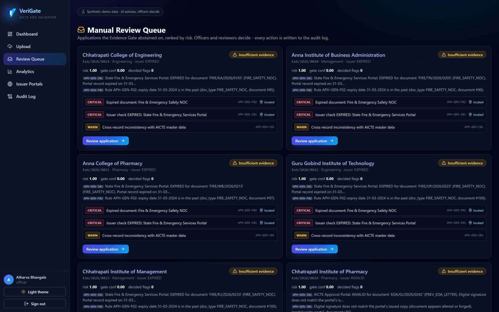 | **Append-only audit trail with filters**<br>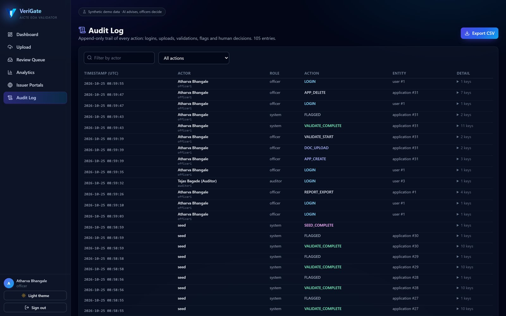 |
| **Submitted values vs AICTE master record**<br>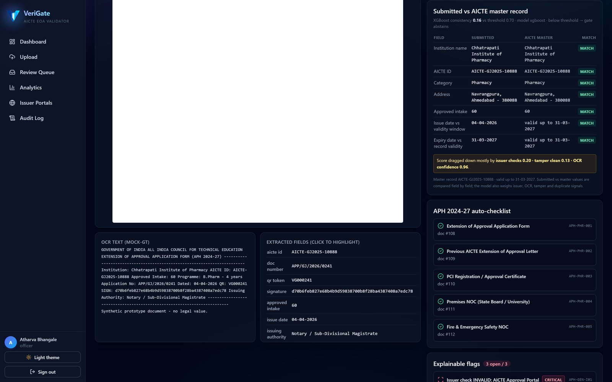 | **Duplicate document pair with hash distance**<br>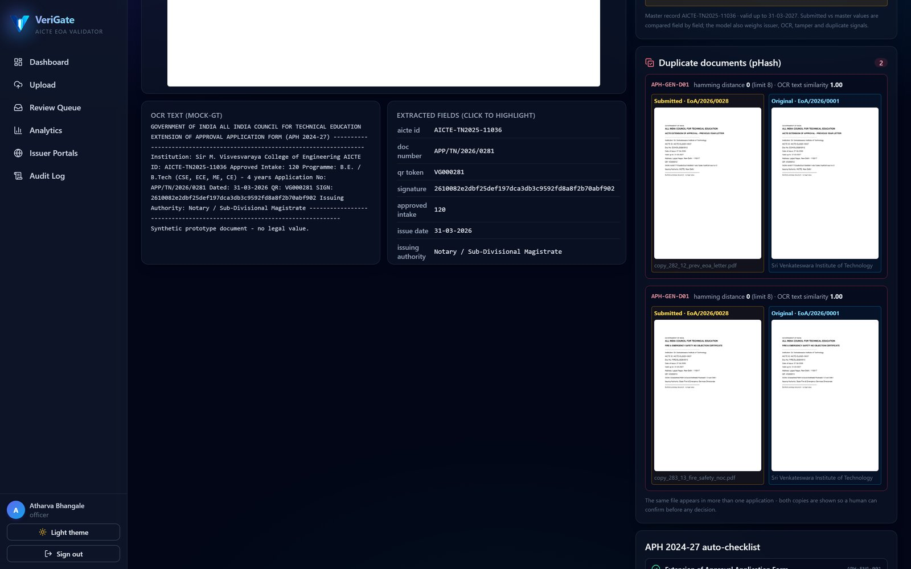 |
| **Issuer portal health and verification outcomes**<br>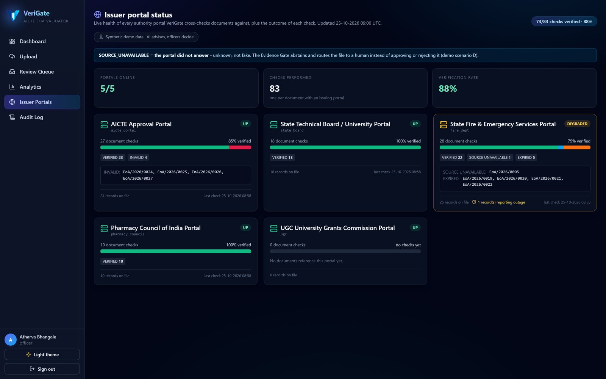 | **Portfolio analytics and rule-frequency trends**<br>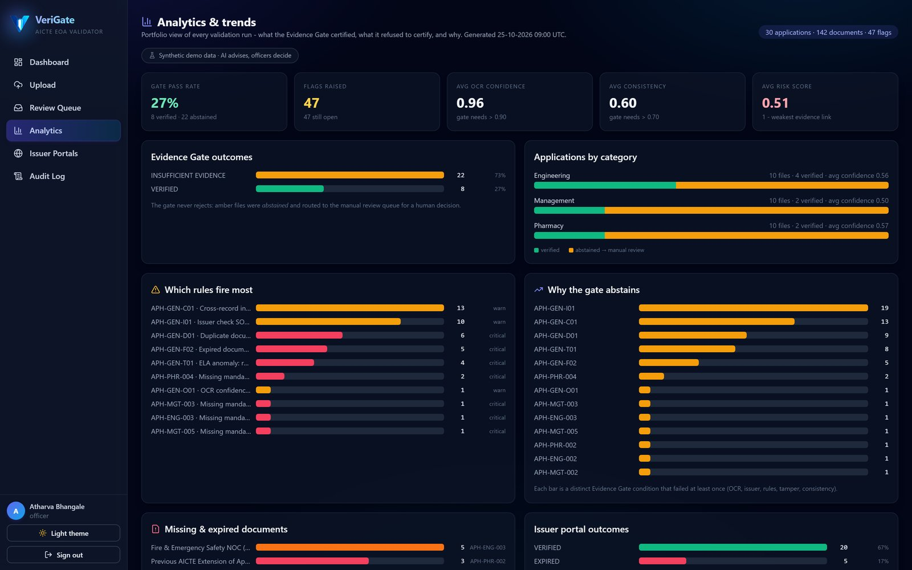 |

> High-resolution originals (3200 × 2000) are generated by `frontend/scripts/screenshots.mjs` into `frontend/screenshots/`. The copies in `docs/screenshots/` are compressed for GitHub.

#### 11.4 Explainable flag example

```json
{
  "rule_id": "APH-GEN-T01",
  "kind": "TAMPER",
  "severity": "CRITICAL",
  "title": "ELA anomaly: region with anomalous recompression",
  "reason": "Error Level Analysis on 'prev_eoa_letter.pdf' page 1 found a hot region
             at (0.10, 0.28) size (0.19 x 0.02) with tamper score 0.62 — consistent
             with a pasted/edited region.",
  "document_id": 242,
  "page_no": 1,
  "bbox": [0.10, 0.28, 0.19, 0.02]
}
```

The UI positions this box directly over the rendered page. Red indicates a critical finding; orange indicates a warning; blue indicates an extracted field.

#### 11.5 API surface (selected)

```
POST   /auth/login                              JWT login
POST   /applications                            create application (officer)
POST   /applications/{id}/documents             upload documents (officer)
POST   /applications/{id}/validate              run nine-step pipeline
GET    /applications?status=&category=&q=       risk-ranked list
GET    /applications/{id}                       detail: documents, flags, checklist, gate
GET    /applications/{id}/flags                 explainable flags
GET    /applications/{id}/report                A4 PDF verification report
GET    /applications/{id}/consistency           submitted vs AICTE master values
GET    /applications/{id}/duplicates            duplicate pairs
GET    /applications/{id}/documents/{doc}/pages/{n}.png   authenticated page image
GET    /applications/{id}/documents/{doc}/ela.png         ELA heatmap
POST   /reviews/{flag_id}/decision              APPROVE | REJECT | REQUEST_INFO
GET    /reviews/queue                           manual review queue
GET    /audit-log                               filterable audit history
GET    /audit-log/export                        CSV export
GET    /dashboard/stats                         counts + gate pass rate
GET    /dashboard/analytics                     portfolio analytics
GET    /issuer/status                           issuer portal health
GET    /health                                  service + model status
```

#### 11.6 Roles and safeguards in the build

| Role | Rights |
|---|---|
| **Officer** | Create applications, upload, validate, review, delete an application (two-step confirmation, audited) |
| **Reviewer** | Record approve / reject / request-information decisions with comments |
| **Auditor** | Read-only across all screens; export audit CSV; every write endpoint returns 403 |

- Passwords are stored as salted PBKDF2-SHA256 hashes.
- Tokens are signed JWTs with expiry; every request is re-checked against the user record.
- The audit log has no update or delete endpoint.
- The pipeline is failure-isolated: an errored step marks the run as errored and the gate abstains rather than returning a false positive.

#### 11.7 Verification performed

| Test | Coverage |
|---|---|
| Scenario test | All five demo scenarios A–E, gate outcomes, flags, bboxes |
| Role matrix | Officer, reviewer, auditor and anonymous access |
| Delete test | Role guards, reference uniqueness, file cleanup, audit entry |
| UI end-to-end | Headless Chrome walkthrough: login, dashboard, overlays, queue, export (25 checks) |
| Reset / reseed | Deterministic 30-application dataset for repeatable demos |

---

### 12. Innovation and Uniqueness

1. **The Evidence Gate (abstention by design).** Most "AI verification" systems force a yes/no answer. VeriGate explicitly refuses to certify when any evidence link is weak. This inverts the usual failure mode: instead of occasional false approvals, uncertain cases are handed to humans with reasons. The gate is a regulatory safety property, not a model accuracy claim.

2. **Weakest-link confidence, not an average.** A single unverified Fire NOC cannot be hidden by eleven strong signals. Confidence is the minimum of OCR, consistency, tamper inverse and issuer score.

3. **Evidence-linked flags, not just labels.** Every finding carries a rule ID, human-readable reason, document, page, normalised bounding box, severity and timestamp. A reviewer can see *exactly* where the machine looked.

4. **Built for regulatory change.** APH requirements are versioned JSON configuration. A new cycle or category is a configuration update, not a model retrain or code rewrite.

5. **Issuer outages never become adverse action.** `SOURCE_UNAVAILABLE` routes to manual confirmation. The system distinguishes "not verified" from "verified false" — a distinction that matters legally and ethically.

6. **Duplicate detection that understands templates.** pHash alone flags two different certificates printed on the same template. VeriGate requires both a close perceptual hash *and* near-identical OCR text, which separates genuine reuse from legitimate shared layout.

7. **Tamper detection tuned for rendered documents.** Classic ELA false-positives on anti-aliased text. Restricting analysis to flat regions and requiring solid 2×2 block clusters makes the signal usable on ordinary certificates.

8. **Audit by construction.** Validation, source queries, exports, deletions and human decisions are written to an append-only log as they happen. There is deliberately no API to edit history.

9. **CPU-only and deterministic for demonstration.** The entire prototype runs without a GPU or external model download. A seeded ground-truth path guarantees the demo never fails because of a heavy dependency, while the real OCR engine chain remains available.

10. **Human sign-off is part of the artefact.** The downloadable report contains both the machine verdict and a blank final-decision block for the competent officer, making the division of responsibility explicit.

---

### 13. Feasibility and Scalability

#### 13.1 Technical feasibility

| Aspect | Assessment |
|---|---|
| Core stack | Mature open-source components (FastAPI, React, SQLAlchemy, PyMuPDF, XGBoost, NumPy) — no exotic dependency |
| Compute | Prototype runs on CPU; OCR is the main cost and can be scaled independently |
| Data | Works with PDFs and scanned images; no proprietary format required |
| Integration | Issuer layer is an adapter contract; mock and HTTP modes already demonstrate the boundary |
| Failure behaviour | Every pipeline step is isolated; the gate abstains on error |
| Accuracy risk | OCR on poor scans and Indian-language documents is the main technical risk; mitigated by engine fallback, confidence thresholds and mandatory human review |

#### 13.2 Operational feasibility

- Fits the existing workflow as a **pre-scrutiny layer**; officers keep their authority and their tools.
- Role separation matches how approval bureaus already work.
- The report is printable and signable, so it can enter a physical file if required.
- Configuration-driven rules let AICTE's approval bureau own the checklist without engineering effort.
- Deployment can be on-premise or in a government cloud; no data must leave the authorised environment.

#### 13.3 Legal and ethical feasibility

| Requirement | Design response |
|---|---|
| Final decision with competent authority | The system cannot approve or reject; it only marks evidence sufficiency and routes to humans |
| No bypassing access controls | Only authorised APIs/portals; adapter layer, consent-based DigiLocker/API Setu integration |
| Data protection | Role-based access, PBKDF2 password hashing, JWT expiry, append-only audit, configurable retention |
| Explainability | Rule ID, reason, document, page, bbox and confidence on every flag |
| Forgery presumption | Findings are labelled preliminary indicators requiring human verification, never proof of misconduct |
| DPDP Act, 2023 alignment | Purpose limitation, data minimisation, access logging and retention controls are architectural requirements for the pilot |

#### 13.4 Scalability plan

| Stage | Volume | Architecture |
|---|---|---|
| **Pilot** | One bureau / one State, hundreds of applications | Current FastAPI + PostgreSQL + object storage, 2–4 CPU workers |
| **State roll-out** | Tens of thousands of applications per cycle | Stateless API replicas behind a load balancer; Redis queue + Celery workers for OCR/ELA; shared PostgreSQL; S3-compatible object storage |
| **National** | Full annual cycle | Horizontal OCR worker pool (CPU or GPU), cached issuer responses, partitioned tables, read replicas, observability and rate-limited issuer gateways |

**Scaling levers:** OCR is separable from rule evaluation; issuer calls are the only external dependency and are cacheable by document identity; ELA/pHash are per-page and parallelisable; the gate itself is O(1) per application.

**Indicative cost:** at pilot scale, a single modest CPU server plus object storage is sufficient. The dominant variable cost is OCR compute per page; caching and only re-processing changed documents keep it bounded.

#### 13.5 Risk register

| Risk | Impact | Mitigation |
|---|---|---|
| Real issuer APIs unavailable or restricted | Verification coverage limited | Adapter per source; manual fallback; status `SOURCE_UNAVAILABLE`; start with DigiLocker-covered document types |
| OCR errors on poor scans | False flags or abstentions | Confidence threshold, engine fallback, human review; never auto-reject |
| Rule drift across APH cycles | Wrong checklist | Versioned rules, change log, approval workflow for rule updates |
| Model false positives | Reviewer fatigue | Conservative thresholds, evidence links, feedback loop, periodic calibration |
| Data sensitivity | Legal and reputational risk | On-prem deployment, least privilege, encryption, retention policy, audit |
| Automation bias | Officers over-trust the gate | UI language, mandatory comments, sign-off block, sampling audits |

---

### 14. Expected Outcomes

#### 14.1 Benefits by stakeholder

| Stakeholder | Benefit |
|---|---|
| **AICTE officials** | Less repetitive scrutiny; risk-ranked queue; consistent rule application; evidence-linked cases |
| **Institutions** | Earlier, clearer deficiency feedback; fewer rejection cycles caused by missing or expired documents |
| **Issuing authorities** | Structured, minimal queries instead of ad-hoc correspondence |
| **Auditors / oversight** | Complete, timestamped trail of rules, sources, flags and decisions |
| **Citizens / students** | Faster, more predictable approval processing and greater trust in the process |

#### 14.2 Measurable targets (evaluation plan)

These are targets for the pilot evaluation, not claims about the current prototype.

| Metric | How it is measured | Target |
|---|---|---|
| Document extraction accuracy | Character/word accuracy against a labelled synthetic/authorised set | ≥ 95% on machine-generated PDFs; report separately for scans |
| Checklist correctness | Agreement with expected outcome on curated cases | 100% on the scenario set |
| Critical-defect safety | Applications with a known critical defect marked `VERIFIED` | 0 |
| Anomaly precision | Seeded tamper/duplicate cases flagged vs total flags | ≥ 90% on the seeded set |
| Tamper localisation | Correct page and IoU of predicted bbox with ground truth | ≥ 0.5 IoU on scenario C |
| Issuer verification coverage | Document types with a live authorised source | Baseline measured per integration wave |
| Verification time | Median end-to-end pipeline time per application | < 2 minutes for 5 documents at pilot scale |
| Manual effort reduction | Time-and-motion study of officer minutes per case, before vs after | 40–60% reduction on pre-screened cases |
| Alert timeliness | Time from upload to deficiency notification | Same session (< 5 minutes) |
| Audit completeness | Actions recorded vs actions performed | 100% |
| Reviewer agreement | Share of gate abstentions where reviewer agrees extra scrutiny was needed | Tracked, target ≥ 70% |

#### 14.3 Prototype evidence

On a fresh seed, the demonstration dataset contains 30 synthetic applications spanning three categories and five intended behaviours. The gate separates clean from deficient evidence: a subset is marked `VERIFIED`, the remainder is routed to review with explainable reasons. Because the data is synthetic, these counts demonstrate **workflow behaviour**, not real-world accuracy. Accuracy claims will come from the evaluation plan above.

#### 14.4 Impact statement

VeriGate does not replace regulatory judgement. It reduces the distance between submission and a well-evidenced decision: deficiencies surface earlier, verification is traceable, rules are applied uniformly, and officers spend their time on cases and questions that genuinely need a human.

---

### 15. Future Scope

| Phase | Enhancement | Value |
|---|---|---|
| **Near term** | Real OCR and layout models (LayoutLMv3, Donut, TrOCR); Hindi/regional language support | Higher extraction accuracy on scans and tables |
| **Near term** | Live DigiLocker / API Setu integration for issued certificates | Consent-based authentic documents, fewer manual uploads |
| **Near term** | PDF digital-signature and QR validation (CCA/eSign) | Cryptographic provenance instead of visual checks |
| **Near term** | Rule-authoring UI with versioning and approval workflow | AICTE can update APH rules without engineering |
| **Mid term** | Learned tamper detection (DocTamper-style) on photographed/re-scanned documents | Better coverage than ELA alone |
| **Mid term** | Infrastructure evidence review: photo/video consistency, floor-plan parsing, lab and built-up-area checks | Supports the infrastructure-compliance objective |
| **Mid term** | Faculty, intake and programme cross-checks against AICTE records; TER payment and application-history signals | Broader consistency coverage |
| **Mid term** | Email/SMS/in-app alerts and SLA timers; reviewer workload balancing | Faster resolution, fewer stalled files |
| **Long term** | Active learning from reviewer decisions; calibration dashboard; drift monitoring | Continuous improvement without compromising safety |
| **Long term** | Native AICTE portal / NSWS integration and single sign-on | Frictionless adoption |
| **Long term** | Regional-language interface and mobile reviewer app | Accessibility for institutions and field officers |
| **Long term** | Optional tamper-evident notarisation of report hashes | Stronger long-term audit integrity |
| **Long term** | On-prem / air-gapped deployment package with observability and backup | Government data-sovereignty requirements |

**Explicit non-goals:** automated rejection, automated approval, replacing inspection, or using AI findings as conclusive proof of forgery.

---

### 16. References

1. All India Council for Technical Education. *Approval Process Handbook 2024-25 to 2026-27.* AICTE, New Delhi. https://cdnbbsr.s3waas.gov.in/s35938b4d054136e5d59ada6ec9c295d7a/uploads/2025/03/2025031399.pdf
2. AICTE. *Approval Process 2025-26 — Important Documents / Attachments.* https://www.aicte.gov.in/approval-process-2024-25-attachments
3. AICTE. *List of Documents to be Uploaded on Portal by New Institutes & Existing Institutes (Chapter-1 Categories).* https://www.aicte.gov.in/sites/default/files/New%20Institutes%20&%20Existing%20Institutes%20(Chapter-1%20Categories).pdf
4. AICTE. *Annexure 16 & 17 — Documents for EoA of Existing Institutions.* https://www.aicte.gov.in/sites/default/files/Annexure_16_17.pdf
5. AICTE. *Approval Process 2025-2026 (portal).* https://www.aicte.gov.in/approal-process-2024-2027
6. Smart India Hackathon. *Problem Statement SIH26261 — AI-Powered Application Validation, Document Authentication and Regulatory Compliance Verification.* https://www.sih.gov.in/sih2026PS
7. Government of India. *All India Council for Technical Education Act, 1987.* India Code. https://www.indiacode.nic.in
8. Government of India. *Digital Personal Data Protection Act, 2023 (No. 22 of 2023).* Ministry of Electronics and Information Technology. https://www.meity.gov.in/data-protection-framework
9. Government of India. *Information Technology Act, 2000* — Section 3A (electronic signatures) and Section 65B (admissibility of electronic records). India Code. https://www.indiacode.nic.in
10. DigiLocker. *Partners — Requesters (consent-based document access).* https://www.digilocker.gov.in/web/partners/requesters
11. API Setu. *DigiLocker Issuer / Requester API specifications.* https://apisetu.gov.in/digilocker
12. Qu, C., et al. "Towards Robust Tampered Text Detection in Document Image: New Dataset and New Solution." *Proceedings of the IEEE/CVF Conference on Computer Vision and Pattern Recognition (CVPR)*, 2023.
13. Huang, Y., Lv, T., Cui, L., Lu, Y., and Wei, F. "LayoutLMv3: Pre-training for Document AI with Unified Text and Image Masking." *Proceedings of the 30th ACM International Conference on Multimedia*, 2022.
14. Kim, G., et al. "OCR-free Document Understanding Transformer (Donut)." *European Conference on Computer Vision (ECCV)*, 2022.
15. Li, M., et al. "TrOCR: Transformer-based Optical Character Recognition with Pre-trained Models." *Proceedings of the AAAI Conference on Artificial Intelligence*, 2023.
16. Chen, T., and Guestrin, C. "XGBoost: A Scalable Tree Boosting System." *Proceedings of the 22nd ACM SIGKDD International Conference on Knowledge Discovery and Data Mining*, 2016.
17. Krawetz, N. "A Picture's Worth: Digital Image Analysis and Forensics." *Black Hat Briefings*, 2007. (Error Level Analysis)
18. Zauner, C. *Implementation and Benchmarking of Perceptual Image Hash Functions.* Master's thesis, Upper Austria University of Applied Sciences, 2010. (pHash)
19. Smith, R. "An Overview of the Tesseract OCR Engine." *Proceedings of the Ninth International Conference on Document Analysis and Recognition (ICDAR)*, 2007.
20. Du, Y., et al. "PP-OCR: A Practical Ultra Lightweight OCR System." arXiv:2009.09941, 2020.
21. OWASP Foundation. *OWASP Application Security Verification Standard (ASVS) 4.0.3.* https://owasp.org/www-project-application-security-verification-standard/
22. International Organization for Standardization. *ISO/IEC 27001:2022 — Information security, cybersecurity and privacy protection — Information security management systems — Requirements.*
23. Controller of Certifying Authorities, Government of India. *Digital Signature / eSign guidelines and licensed CA framework.* https://cca.gov.in
24. FastAPI. *Documentation.* https://fastapi.tiangolo.com
25. React. *Documentation.* https://react.dev

---

> VeriGate is a decision-support prototype. It does not grant approval, reject an application, or establish forgery. All statutory scrutiny, inspection and final decisions remain with the competent AICTE authorities.
